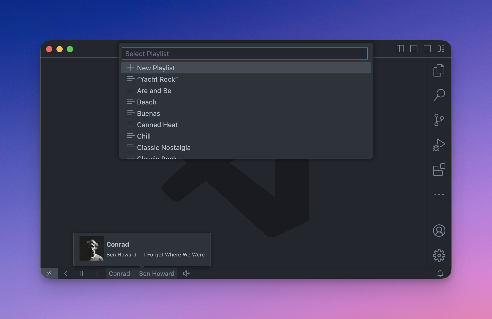

# Apple Music Player - Visual Studio Code

Apple Music client for Visual Studio Code — _only available for macOS_



## Features

- Shows the current song in every status-bar layout, with artwork in its tooltip.
- Provides a Now Playing action menu for common controls without leaving the editor.
- Searches Apple Music library tracks and playlists, then plays the selected result.
- Toggles favorites, manages playlists, seeks within tracks, and controls volume, shuffle, and repeat mode.
- Associates a soundtrack with each workspace, with optional automatic playback when it opens.
- Offers `compact`, `full`, and `trackOnly` status-bar layouts alongside a focused set of [commands](#supported-commands).
- Checks the local Apple Music and macOS Automation setup when something is not working.

## Supported Commands

Every command below is available from the Command Palette. The Status Bar Layouts column lists presets that also expose a direct control; `all` means `compact`, `full`, and `trackOnly`.

| Feature                    | Status Bar Layouts |
| -------------------------- | ------------------ |
| Play/Pause                 | `compact`, `full`  |
| Mute/Unmute                | `full`             |
| Previous Track             | `full`             |
| Next Track                 | `full`             |
| Show Now Playing Actions   | `all`              |
| Toggle Favorite            | —                  |
| Search Apple Music         | —                  |
| Seek Forward               | —                  |
| Seek Backward              | —                  |
| Restart Track              | —                  |
| Add to Library             | —                  |
| Add to Playlist            | —                  |
| Set Volume                 | —                  |
| Volume Up                  | —                  |
| Volume Down                | —                  |
| Set Repeat Mode            | —                  |
| Toggle Shuffle             | —                  |
| Copy Track Info            | —                  |
| Reveal Current Track in Music | —               |
| Workspace Soundtrack…      | —                  |
| Toggle Status Bar Controls | —                  |
| Check Setup                | —                  |
| Open Music                 | —                  |

**Search Apple Music** returns matching tracks and playlists. Selecting a playlist starts it immediately while preserving Music's current shuffle state, without an extra playback-mode prompt. **Add to Playlist** can create a new playlist, and **Workspace Soundtrack…** selects, plays, or clears the soundtrack for the current workspace.

Legacy command IDs remain registered for existing keybindings and automation, but redundant variants are hidden from the Command Palette. The extension no longer installs default keybindings; assign any commands you want through VS Code's Keyboard Shortcuts editor.

## Configuration

```jsonc
{
  // Choose a status-bar layout: compact, full, or trackOnly.
  "vscodeAppleMusic.statusBarLayout": "compact",
  // The step size for volume control.
  "vscodeAppleMusic.volumeStep": 6.25,
  // The number of seconds to seek forward or backward.
  "vscodeAppleMusic.seekStep": 15,
  // Show the Apple Music status bar controls on startup.
  "vscodeAppleMusic.showOnStartup": true,
  // Automatically play the selected soundtrack when its workspace opens.
  "vscodeAppleMusic.autoPlayWorkspaceSoundtrack": false
}
```

## Requirements

- macOS with the Music app.
- Permission for Visual Studio Code to control Music. macOS normally asks the first time an Apple Music command runs. Choose **OK** when prompted.

If commands do not work, run **Apple Music: Check Setup** from the Command Palette. You can also open **System Settings > Privacy & Security > Automation** and enable Music access for Visual Studio Code (or the VS Code edition you use).

## Release Notes

### 1.9.0 (Unreleased)

- Add a Now Playing action menu, favorites, library search, seeking and restart controls, direct volume and repeat selection, track copying, and reveal-in-Music support.
- Add configurable seek steps.
- Add per-workspace soundtracks with optional automatic playback.
- Add Apple Music and macOS Automation setup diagnostics.
- Improve AppleScript command reliability with serialized execution, timeouts, and clearer errors.
- Replace individual status-bar visibility settings with `compact`, `full`, and `trackOnly` layout presets.
- Streamline the Command Palette with state-aware favorite and status-bar actions, unified track and playlist search, and one workspace soundtrack manager.
- Remove bundled keybindings and the advanced polling setting from the public configuration surface.
- Hide Quit Music from the Command Palette while retaining its legacy command ID.

### 1.8.1

- Fix playlist commands for names containing quotes or other special characters.
- Fix malformed playlist and now-playing data when names or metadata contain JSON-sensitive characters.
- Fix Add to Playlist targeting duplicate tracks with the same artist and title; it now uses the current track's persistent ID.
- Keep now-playing information visible when artwork is missing or unreadable, and render local artwork correctly.

### 1.7.0

- Add 'showOnStartup' configuration
- Fix issue with album names containing quotes

### 1.6.0

- Add 'Play Playlist'
- Add 'Shuffle Playlist'
- Migrate tooling

### 1.5.0

- Add 'Add to Library'
- Add 'Add to Playlist'
- Add ability to create a new playlist
- Add default keybindings
- Add configuration options

### 1.4.0

- Add show/hide commands
- Add quit command

### 1.3.0

- Add a ton of new commands
- Fix album artwork issue causing artwork to not display in certain cases

### 1.2.3

- Fix setInterval bug

### 1.2.2

- Add a tooltip with track and album art information
- Fix issue with volume when muting and unmuting

### 1.2.1

- Bug fix for stopped player state

### 1.2.0

- Fix issue where player state is not syncing correctly
- Make UI more responsive to actions
- Add activation events to extension

### 1.0.1

- Update `package.json` configuration for Azure Marketplace

### 1.0.0

- Initial release
